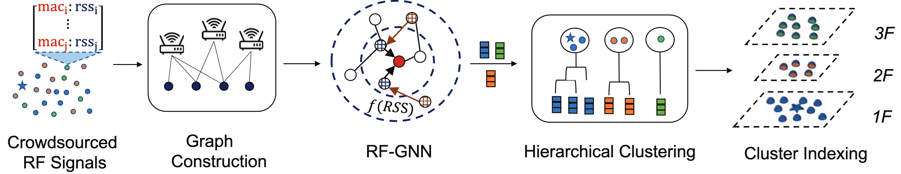

# FIS-ONE: Floor Identification System with One Label for Crowdsourced RF Signals [ICDCS 2023]

This is the official implementation of the paper: <br/>
> **FIS-ONE: Floor Identification System with One Label for Crowdsourced RF Signals**
> 
> Weipeng Zhuo, Ka Ho Chiu, Jierun Chen, Ziqi Zhao, S.-H. Gary Chan, Sangtae Ha, Chul-Ho Lee       
> *IEEE International Conference on Distributed Computing Systems (ICDCS), 2023*

## Overview

Floor labels of crowdsourced RF signals are crucial for many smart-city applications, such as multi-floor indoor localization, geofencing, and robot surveillance. To build a prediction model to identify the floor number of a new RF signal upon its measurement, conventional approaches using the crowdsourced RF signals assume that at least few labeled signal samples are available on each floor. In this work, we push the envelope further and demonstrate that it is technically feasible to enable such floor identification with only one floor-labeled signal sample on the bottom floor while having the rest of signal samples unlabeled. We propose FIS-ONE, a novel floor identification system with only one labeled sample. FIS-ONE consists of two steps, namely signal clustering and cluster indexing. We first build a bipartite graph to model the RF signal samples and obtain a latent representation of each node (each signal sample) using our attention-based graph neural network model so that the RF signal samples can be clustered more accurately. Then, we tackle the problem of indexing the clusters with proper floor labels, by leveraging the observation that signals from an access point can be detected on different floors, i.e., signal spillover. Specifically, we formulate a cluster indexing problem as a combinatorial optimization problem and show that it is equivalent to solving a traveling salesman problem, whose (near-)optimal solution can be found efficiently. We have implemented FIS-ONE and validated its effectiveness on the Microsoft dataset and in three large shopping malls. Our results show that FIS- ONE outperforms other baseline algorithms significantly, with up to 23 % improvement in adjusted rand index and 25% improvement in normalized mutual information using only one floor-labeled signal sample.



## Getting Started

1. Run prep_folder.py to generate edgelist from the raw input.
2. Run gen_emb.py to generate embeddings for each sample.
3. Run test.py to cluster the signals and get the results.

## Bibliography

If you find this work useful, please consider citing it.

```
@INPROCEEDINGS {10272527,
author = { Zhuo, Weipeng and Chiu, Ka Ho and Chen, Jierun and Zhao, Ziqi and Chan, S.-H. Gary and Ha, Sangtae and Lee, Chul-Ho },
booktitle = { 2023 IEEE 43rd International Conference on Distributed Computing Systems (ICDCS) },
title = {{ FIS-ONE: Floor Identification System with One Label for Crowdsourced RF Signals }},
year = {2023},
volume = {},
ISSN = {},
pages = {418-428},
keywords = {Representation learning;Surveillance;RF signals;Traveling salesman problems;Predictive models;Floors;Robots},
doi = {10.1109/ICDCS57875.2023.00039},
url = {https://doi.ieeecomputersociety.org/10.1109/ICDCS57875.2023.00039},
publisher = {IEEE Computer Society},
address = {Los Alamitos, CA, USA},
month =Jul}
```
